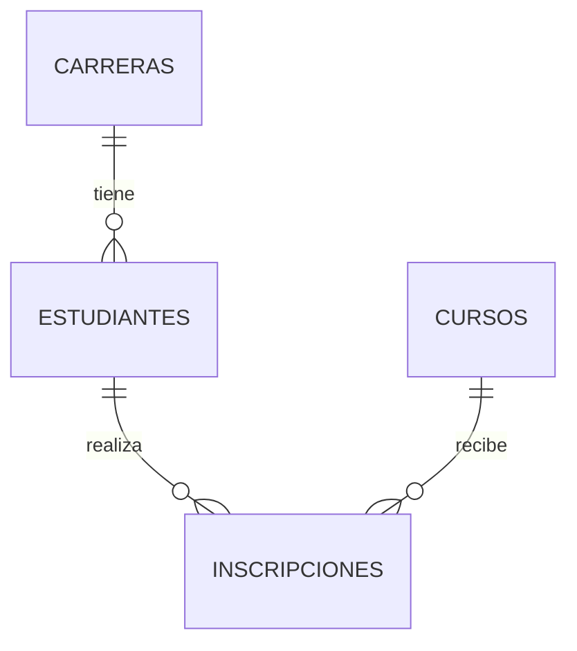

# CRUD Docker — Gestión Académica (Flask + MySQL)

Proyecto académico de **DevOps** que evoluciona el CRUD original de Flask hacia una
aplicación contenerizada, con base de datos relacional, healthchecks, datos de
ejemplo, pruebas automatizadas y CI.

> **Estado: Avance 2.** Se completó el CRUD de los cuatro recursos y se añadió
> una interfaz gráfica servida por Flask. La infraestructura DevOps del Avance 1
> (Docker, Compose, healthchecks, pruebas y CI) se mantiene y se amplía.

## Arquitectura

```text
┌──────────────────┐        HTTP :5000        ┌──────────────────┐
│ Navegador / curl │ ───────────────────────► │ app (Flask)      │
│ UI + API REST    │                          │ Gunicorn + 2 w.  │
└──────────────────┘                          └────────┬─────────┘
                                                       │ SQL :3306
                                                       ▼
                                              ┌──────────────────┐
                                              │ db (MySQL 8.4)   │
                                              │ volumen: mysql_  │
                                              │ data             │
                                              └──────────────────┘
```

- `app` espera a que `db` esté **saludable** (`depends_on: service_healthy`).
- El entrypoint espera la conexión, crea el esquema y carga datos de ejemplo (idempotente).
- La aplicación corre con **usuario no root** y **Gunicorn**, no con el servidor de desarrollo.
- Adminer (opcional) permite inspeccionar la base desde el navegador.
- La misma aplicación sirve el panel web y la API REST; el frontend consume la API con `fetch`.
- El `Makefile` es un atajo opcional; todos los comandos funcionan con `docker compose`.

## Modelo de datos

Cuatro tablas relacionadas:



| Tabla          | Campos principales                                                                 |
| -------------- | ---------------------------------------------------------------------------------- |
| `carreras`     | `id`, `nombre` (único), `facultad`, `created_at`                                     |
| `estudiantes`  | `id`, `nombre`, `apellido`, `email` (único), `carrera_id` (FK), `fecha_registro`     |
| `cursos`       | `id`, `codigo` (único), `nombre`, `creditos`, `profesor`                             |
| `inscripciones`| `id`, `estudiante_id` (FK), `curso_id` (FK), `periodo`, `nota`, `fecha_registro`     |

`inscripciones` implementa la relación muchos-a-muchos entre estudiantes y cursos,
con restricción única por `(estudiante_id, curso_id, periodo)` y `nota` entre 0 y 20.

## Puesta en marcha

Requisitos: Docker Engine y Docker Compose v2. El `Makefile` es opcional: si no
tienes `make`, ejecuta los mismos comandos con `docker compose`.

```bash
# 1. (Opcional) personalizar credenciales y puertos
cp .env.example .env

# 2. Construir y levantar app + MySQL
docker compose up -d --build

# 3. Verificar
curl http://localhost:5000/health
curl http://localhost:5000/
```

Servicios:

| Servicio  | URL                          | Notas                                  |
| --------- | ---------------------------- | -------------------------------------- |
| Panel web | http://localhost:5000        | Interfaz gráfica de la aplicación      |
| API       | http://localhost:5000/<recurso> | JSON (`/estudiantes`, `/carreras`, ...) |
| MySQL     | `localhost:3307`             | `MYSQL_PORT`; usuario `devops`         |
| Adminer   | http://localhost:8081        | `make adminer` (perfil `tools`)        |

En Adminer usa: servidor `db`, usuario `devops`, contraseña `devops123` y base
`devops_db`.

Detener sin perder datos: `make down`. Borrar también la base: `make clean` (destructivo).

### Datos de ejemplo

Al iniciar con `SEED_DATA=true` se cargan 3 carreras, 4 cursos, 4 estudiantes y
5 inscripciones. La carga solo ocurre si la tabla `carreras` está vacía.

## Interfaz gráfica

El panel está disponible en **http://localhost:5000/** y permite:

- Consultar, crear, editar y eliminar carreras, cursos, estudiantes e inscripciones.
- Ver los totales por recurso y el estado de la conexión con la base de datos.
- Usar formularios con validación y mensajes de error devueltos por la API.
- Diseño responsive, sin dependencias externas ni build step.

La interfaz vive en `app/templates/` y `app/static/`, y consume la misma API REST.

## Endpoints

| Método    | Ruta                     | Descripción                                           |
| --------- | ------------------------ | ----------------------------------------------------- |
| GET       | `/`                      | Panel web (HTML)                                      |
| GET       | `/health`                | Estado de la app y de la conexión a la BD             |
| GET       | `/carreras`              | Lista de carreras                                     |
| GET       | `/carreras/<id>`         | Detalle de una carrera                                |
| POST      | `/carreras`              | Crea una carrera (`nombre`, `facultad`)                |
| PUT/PATCH | `/carreras/<id>`         | Actualiza nombre y/o facultad                         |
| DELETE    | `/carreras/<id>`         | Elimina una carrera sin estudiantes                   |
| GET       | `/estudiantes`           | Lista estudiantes (`?carrera_id=` opcional)           |
| GET       | `/estudiantes/<id>`      | Detalle de un estudiante                              |
| POST      | `/estudiantes`           | Crea un estudiante                                    |
| PUT/PATCH | `/estudiantes/<id>`      | Actualiza los campos enviados                         |
| DELETE    | `/estudiantes/<id>`      | Elimina un estudiante sin inscripciones               |
| GET       | `/cursos`                | Lista de cursos                                       |
| GET       | `/cursos/<id>`           | Detalle de un curso                                   |
| POST      | `/cursos`                | Crea un curso                                         |
| PUT/PATCH | `/cursos/<id>`           | Actualiza los campos enviados                         |
| DELETE    | `/cursos/<id>`           | Elimina un curso sin inscripciones                    |
| GET       | `/inscripciones`         | Lista inscripciones (`?estudiante_id=`, `?periodo=`)  |
| GET       | `/inscripciones/<id>`    | Detalle de una inscripción                            |
| POST      | `/inscripciones`         | Inscribe a un estudiante en un curso                  |
| PUT/PATCH | `/inscripciones/<id>`    | Actualiza periodo y/o nota                            |
| DELETE    | `/inscripciones/<id>`    | Elimina una inscripción                               |

Ejemplos:

```bash
curl -X POST http://localhost:5000/carreras \
  -H 'Content-Type: application/json' \
  -d '{"nombre": "Ingeniería de Software", "facultad": "Ingeniería"}'

curl -X POST http://localhost:5000/estudiantes \
  -H 'Content-Type: application/json' \
  -d '{"nombre": "Ana", "apellido": "Pérez", "email": "ana@example.com", "carrera_id": 1}'

curl -X POST http://localhost:5000/inscripciones \
  -H 'Content-Type: application/json' \
  -d '{"estudiante_id": 1, "curso_id": 1, "periodo": "2026-II", "nota": 18.5}'
```

Errores uniformes: `400` validación, `404` recurso no encontrado, `409` duplicado,
`503` base de datos no disponible en `/health`.

## Variables de entorno

| Variable              | Defecto                       | Uso                                   |
| --------------------- | ----------------------------- | ------------------------------------- |
| `DATABASE_URL`        | SQLite en `instance/`         | Cadena de conexión (acepta `mysql://`)|
| `SECRET_KEY`          | valor de desarrollo           | Clave de Flask                        |
| `SEED_DATA`           | `true`                        | Cargar datos de ejemplo               |
| `MYSQL_DATABASE`      | `devops_db`                   | Base creada por MySQL                 |
| `MYSQL_USER`          | `devops`                      | Usuario de la aplicación              |
| `MYSQL_PASSWORD`      | `devops123`                   | Contraseña de la aplicación           |
| `MYSQL_ROOT_PASSWORD` | `rootpass`                    | Contraseña root (solo demo)           |
| `APP_PORT`            | `5000`                        | Puerto de la API en el host           |
| `MYSQL_PORT`          | `3307`                        | Puerto de MySQL en el host            |

> Para MySQL, `DATABASE_URL` debe usar el driver `mysql+pymysql://`.
> `config.py` normaliza el esquema corto `mysql://` automáticamente.

## Estructura

```text
crud-docker/
├── app/
│   ├── __init__.py          # Fábrica de la aplicación
│   ├── db_init.py           # Creación de esquema + seed
│   ├── extensions.py        # SQLAlchemy
│   ├── models.py            # 4 modelos relacionales
│   ├── seed.py              # Datos de ejemplo idempotentes
│   ├── utils.py             # Helpers de validación/errores
│   ├── wait_for_db.py       # Espera activa de la BD
│   ├── routes/              # Blueprints: ui, health, carreras, cursos, estudiantes, inscripciones
│   ├── static/              # CSS y JavaScript de la interfaz
│   └── templates/           # Plantillas Jinja2 (panel web)
├── scripts/entrypoint.sh    # Entrypoint del contenedor
├── tests/                   # Pruebas con pytest
├── docs/avances.md          # Bitácora del proyecto
├── .github/workflows/ci.yml # CI: pruebas + build de imagen
├── config.py                # Configuración por entorno
├── app.py                   # Entrada para desarrollo local
├── wsgi.py                  # Entrada para Gunicorn
├── Dockerfile
├── docker-compose.yml
├── Makefile
└── requirements*.txt
```

## Desarrollo y pruebas

```bash
# Pruebas en contenedor (no requiere Python local)
docker run --rm -e PYTHONDONTWRITEBYTECODE=1 -v "$PWD":/app -w /app \
  python:3.12-slim sh -c "pip install -q -r requirements-dev.txt && python -m pytest -q -p no:cacheprovider"

# O con make, si está instalado
make test

# Ejecución local con SQLite
python -m venv .venv && source .venv/bin/activate
pip install -r requirements-dev.txt
python app.py
```

La configuración de pruebas usa SQLite en memoria y no carga datos de ejemplo.

## CI

`.github/workflows/ci.yml` se ejecuta en cada push a `main` y en pull requests:

1. Instala dependencias y ejecuta `pytest`.
2. Construye la imagen Docker.

## Documentación del avance

La bitácora detallada (decisiones, evidencias y pendientes) está en
[`docs/avances.md`](docs/avances.md).

## Próximos pasos

- Migraciones de esquema con Flask-Migrate/Alembic.
- Publicación de imagen en un registry y despliegue.
- Observabilidad: logs estructurados y métricas.
- Autenticación y roles para el panel.
