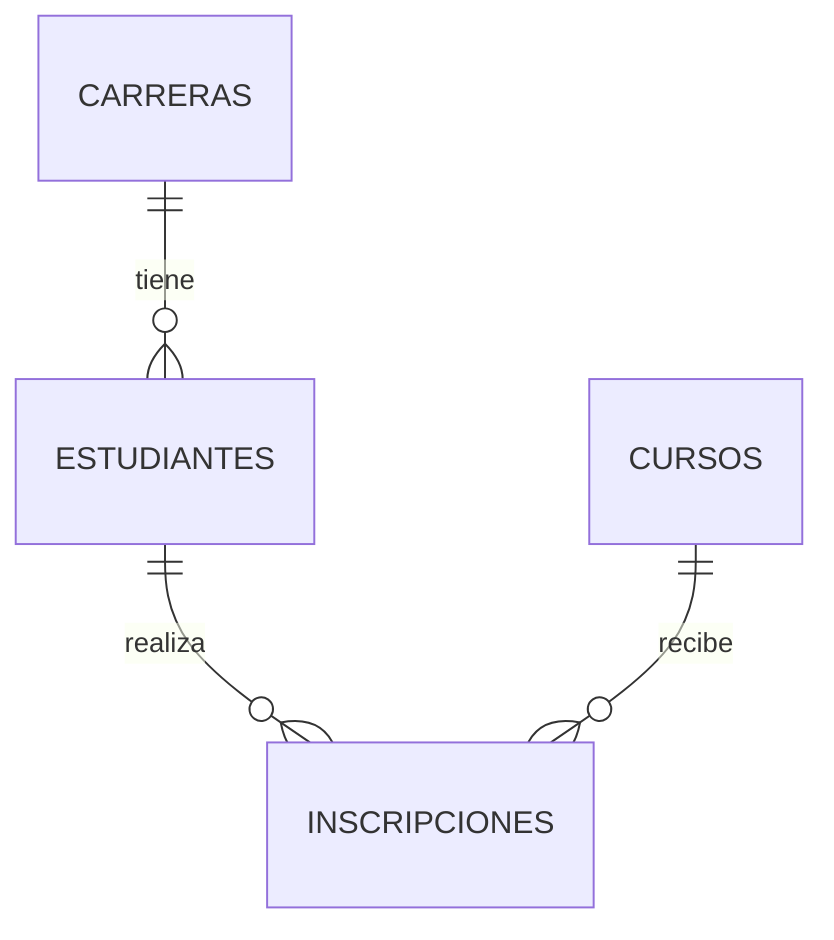

# CRUD Docker — Gestión Académica (Flask + MySQL)

Proyecto académico de **DevOps** que evoluciona el CRUD original de Flask hacia una
aplicación contenerizada, con base de datos relacional, healthchecks, datos de
ejemplo, pruebas automatizadas y CI.

> **Estado: Avance 4 (final).** Se añadió autenticación por sesión con
> Flask-Login y control de roles (`admin` / `lector`) sobre el panel y la API.
> Se mantienen las migraciones, la observabilidad y el CI/CD del Avance 3.

## Arquitectura

```text
┌──────────────────┐        HTTP :5000        ┌──────────────────┐
│ Navegador / curl │ ───────────────────────► │ app (Flask)      │
│ UI + API REST    │                          │ Gunicorn + 2 w.  │
└──────────────────┘                          └────────┬─────────┘
                                                       │ SQL :3306
                                                       ▼
                                              ┌──────────────────┐
                                              │ db (MySQL 8.4)   │
                                              │ volumen: mysql_  │
                                              │ data             │
                                              └──────────────────┘

  Prometheus (:9090, perfil opcional) ──scrape──► app:5000/metrics
```

- `app` espera a que `db` esté **saludable** (`depends_on: service_healthy`).
- El entrypoint espera la conexión, **aplica las migraciones** y carga datos de
  ejemplo (idempotente) antes de arrancar Gunicorn.
- La aplicación corre con **usuario no root** y **Gunicorn**, no con el servidor de desarrollo.
- Adminer (opcional) permite inspeccionar la base desde el navegador.
- La misma aplicación sirve el panel web y la API REST; el frontend consume la API con `fetch`.
- Prometheus (opcional, perfil `observability`) recolecta las métricas de `/metrics`.
- El `Makefile` es un atajo opcional; todos los comandos funcionan con `docker compose`.

## Modelo de datos

Cuatro tablas de dominio relacionadas y una tabla de usuarios para el acceso:



| Tabla          | Campos principales                                                                 |
| -------------- | ---------------------------------------------------------------------------------- |
| `carreras`     | `id`, `nombre` (único), `facultad`, `created_at`                                     |
| `estudiantes`  | `id`, `nombre`, `apellido`, `email` (único), `carrera_id` (FK), `fecha_registro`     |
| `cursos`       | `id`, `codigo` (único), `nombre`, `creditos`, `profesor`                             |
| `inscripciones`| `id`, `estudiante_id` (FK), `curso_id` (FK), `periodo`, `nota`, `fecha_registro`     |
| `usuarios`     | `id`, `nombre`, `email` (único), `password_hash`, `rol`, `activo`, `created_at`      |

`inscripciones` implementa la relación muchos-a-muchos entre estudiantes y cursos,
con restricción única por `(estudiante_id, curso_id, periodo)` y `nota` entre 0 y 20.
`usuarios` almacena únicamente hashes de contraseña (Werkzeug) y roles
`admin` o `lector`.

## Puesta en marcha

Requisitos: Docker Engine y Docker Compose v2. El `Makefile` es opcional: si no
tienes `make`, ejecuta los mismos comandos con `docker compose`.

```bash
# 1. (Opcional) personalizar credenciales y puertos
cp .env.example .env

# 2. Construir y levantar app + MySQL
docker compose up -d --build

# 3. Verificar
curl http://localhost:5000/health

# 4. Abrir el panel e iniciar sesión
#    http://localhost:5000/
#    admin@example.com / admin123   (rol admin)
#    lector@example.com / lector123 (solo lectura)
```

Servicios:

| Servicio  | URL                          | Notas                                  |
| --------- | ---------------------------- | -------------------------------------- |
| Panel web | http://localhost:5000        | Interfaz gráfica de la aplicación      |
| API       | http://localhost:5000/<recurso> | JSON (`/estudiantes`, `/carreras`, ...) |
| Métricas  | http://localhost:5000/metrics | Formato Prometheus                     |
| MySQL     | `localhost:3307`             | `MYSQL_PORT`; usuario `devops`         |
| Adminer   | http://localhost:8081        | `make adminer` (perfil `tools`)        |
| Prometheus| http://localhost:9090        | `make observability` (perfil `observability`) |

En Adminer usa: servidor `db`, usuario `devops`, contraseña `devops123` y base
`devops_db`.

Detener sin perder datos: `make down`. Borrar también la base: `make clean` (destructivo).

### Datos de ejemplo

Al iniciar con `SEED_DATA=true` se cargan 3 carreras, 4 cursos, 4 estudiantes y
5 inscripciones. La carga solo ocurre si la tabla `carreras` está vacía.
Con `SEED_USERS=true` se crean además las cuentas `admin` y `lector` si sus
emails no existen; la operación es idempotente y no sobrescribe contraseñas.

## Migraciones de base de datos

El esquema se versiona con **Flask-Migrate/Alembic** en `migrations/`.

```bash
# Aplicar migraciones pendientes (y datos de ejemplo)
docker compose run --rm --entrypoint python app -m app.bootstrap

# O con make
make migrate
```

El contenedor ejecuta ese mismo bootstrap en cada arranque, por lo que un
`docker compose up` deja la base al día sin pasos manuales.

- Las bases nuevas se crean aplicando la migración inicial.
- Las bases creadas en avances anteriores (sin tabla `alembic_version`) se
  **marcan con `stamp`** en la revisión actual antes de continuar. Así se evita
  recrear tablas existentes y se conservan los datos.
- Para crear una migración nueva tras cambiar los modelos:

  ```bash
  docker compose run --rm --entrypoint flask app --app app db migrate -m "descripcion"
  docker compose run --rm --entrypoint flask app --app app db upgrade
  ```

## Autenticación y roles

El acceso se gestiona con **Flask-Login** y sesiones firmadas por Flask.

| Rol     | Panel                                        | API                                  |
| ------- | -------------------------------------------- | ------------------------------------ |
| `admin` | Ve y modifica todos los recursos             | `GET`, `POST`, `PUT`, `PATCH`, `DELETE` |
| `lector`| Solo consulta; no ve botones de escritura    | Solo `GET`; las escrituras dan `403` |

- `/login` y `/logout` gestionan la sesión; `/health` y `/metrics` son públicos.
- Las cuentas demo se crean al arrancar si no existen (`SEED_USERS=true`).
- Las contraseñas se guardan como hash con Werkzeug; nunca se devuelven por la API.
- La API usa la misma cookie de sesión que el panel. Ejemplo con `curl`:

  ```bash
  curl -c cookies.txt -X POST http://localhost:5000/login \
    -H 'Content-Type: application/json' \
    -d '{"email": "admin@example.com", "password": "admin123"}'

  curl -b cookies.txt http://localhost:5000/carreras

  curl -b cookies.txt -X POST http://localhost:5000/carreras \
    -H 'Content-Type: application/json' \
    -d '{"nombre": "Ingeniería Civil", "facultad": "Ingeniería"}'

  curl -b cookies.txt -X POST http://localhost:5000/logout
  ```

- Para producción: cambia las contraseñas por variables de entorno, usa HTTPS y
  activa `SESSION_COOKIE_SECURE=true`.

## Observabilidad

- **Logs JSON** en stdout: cada petición genera una línea con `method`, `path`,
  `status`, `duration_ms`, `request_id` y `remote_addr`.
- **Request ID**: se respeta `X-Request-ID` si el cliente lo envía y, si no, se
  genera uno; siempre se devuelve en la respuesta.
- **Métricas Prometheus** en `/metrics`: `http_requests_total` y
  `http_request_duration_seconds` por método, endpoint y estado.
- **Soporte multiproceso**: como Gunicorn usa 2 workers, las métricas se agregan
  mediante `PROMETHEUS_MULTIPROC_DIR=/tmp/prometheus`.

```bash
# Métricas en texto Prometheus
curl http://localhost:5000/metrics

# Prometheus + consulta de ejemplo
make observability
curl 'http://localhost:9090/api/v1/query?query=http_requests_total'
```

## CI/CD y publicación de imagen

`.github/workflows/ci.yml` se ejecuta en cada push a `main` y en pull requests:

1. Instala dependencias y ejecuta `pytest`.
2. Construye la imagen Docker.
3. Escanea la imagen con **Trivy** (vulnerabilidades `CRITICAL`/`HIGH`; el
   escaneo es informativo y no bloquea el pipeline).
4. En push a `main`, publica en **GHCR** las etiquetas `latest` y
   `sha-<commit>` usando `GITHUB_TOKEN`.

```bash
# Usar la imagen publicada
echo "APP_IMAGE=ghcr.io/ivanguerra23/proyecto_devops:latest" >> .env
docker compose pull app
docker compose up -d
```

La imagen es privada por defecto en GHCR; para descargarla desde otra máquina
hay que autenticarse con un token con permiso `read:packages`.

## Interfaz gráfica

El panel está disponible en **http://localhost:5000/** y permite:

- Consultar, crear, editar y eliminar carreras, cursos, estudiantes e inscripciones.
- Iniciar y cerrar sesión; la barra superior muestra el usuario y su rol.
- El rol `lector` solo ve las tablas: los botones de escritura se ocultan y la
  API rechaza sus intentos con `403`.
- Ver los totales por recurso y el estado de la conexión con la base de datos.
- Usar formularios con validación y mensajes de error devueltos por la API.
- Diseño responsive, sin dependencias externas ni build step.

La interfaz vive en `app/templates/` y `app/static/`, y consume la misma API REST.

## Endpoints

Las rutas de datos requieren sesión iniciada. Las escrituras (`POST`, `PUT`,
`PATCH`, `DELETE`) requieren además rol `admin`.

| Método    | Ruta                     | Descripción                                           |
| --------- | ------------------------ | ----------------------------------------------------- |
| GET       | `/login`                 | Formulario de inicio de sesión (HTML)                 |
| POST      | `/login`                 | Inicia sesión (JSON o formulario)                     |
| POST      | `/logout`                | Cierra la sesión                                      |
| GET       | `/`                      | Panel web (HTML, requiere sesión)                     |
| GET       | `/health`                | Estado de la app y de la conexión a la BD (público)   |
| GET       | `/metrics`               | Métricas en formato Prometheus (público)              |
| GET       | `/carreras`              | Lista de carreras                                     |
| GET       | `/carreras/<id>`         | Detalle de una carrera                                |
| POST      | `/carreras`              | Crea una carrera (`nombre`, `facultad`)                |
| PUT/PATCH | `/carreras/<id>`         | Actualiza nombre y/o facultad                         |
| DELETE    | `/carreras/<id>`         | Elimina una carrera sin estudiantes                   |
| GET       | `/estudiantes`           | Lista estudiantes (`?carrera_id=` opcional)           |
| GET       | `/estudiantes/<id>`      | Detalle de un estudiante                              |
| POST      | `/estudiantes`           | Crea un estudiante                                    |
| PUT/PATCH | `/estudiantes/<id>`      | Actualiza los campos enviados                         |
| DELETE    | `/estudiantes/<id>`      | Elimina un estudiante sin inscripciones               |
| GET       | `/cursos`                | Lista de cursos                                       |
| GET       | `/cursos/<id>`           | Detalle de un curso                                   |
| POST      | `/cursos`                | Crea un curso                                         |
| PUT/PATCH | `/cursos/<id>`           | Actualiza los campos enviados                         |
| DELETE    | `/cursos/<id>`           | Elimina un curso sin inscripciones                    |
| GET       | `/inscripciones`         | Lista inscripciones (`?estudiante_id=`, `?periodo=`)  |
| GET       | `/inscripciones/<id>`    | Detalle de una inscripción                            |
| POST      | `/inscripciones`         | Inscribe a un estudiante en un curso                  |
| PUT/PATCH | `/inscripciones/<id>`    | Actualiza periodo y/o nota                            |
| DELETE    | `/inscripciones/<id>`    | Elimina una inscripción                               |

Ejemplos (con la cookie de sesión de un usuario `admin`):

```bash
curl -c cookies.txt -X POST http://localhost:5000/login \
  -H 'Content-Type: application/json' \
  -d '{"email": "admin@example.com", "password": "admin123"}'

curl -b cookies.txt -X POST http://localhost:5000/carreras \
  -H 'Content-Type: application/json' \
  -d '{"nombre": "Ingeniería de Software", "facultad": "Ingeniería"}'

curl -b cookies.txt -X POST http://localhost:5000/estudiantes \
  -H 'Content-Type: application/json' \
  -d '{"nombre": "Ana", "apellido": "Pérez", "email": "ana@example.com", "carrera_id": 1}'

curl -b cookies.txt -X POST http://localhost:5000/inscripciones \
  -H 'Content-Type: application/json' \
  -d '{"estudiante_id": 1, "curso_id": 1, "periodo": "2026-II", "nota": 18.5}'
```

Errores uniformes: `400` validación, `401` sin sesión, `403` rol insuficiente,
`404` recurso no encontrado, `409` duplicado, `503` base de datos no disponible
en `/health`.

## Variables de entorno

| Variable              | Defecto                       | Uso                                   |
| --------------------- | ----------------------------- | ------------------------------------- |
| `DATABASE_URL`        | SQLite en `instance/`         | Cadena de conexión (acepta `mysql://`)|
| `SECRET_KEY`          | valor de desarrollo           | Clave de Flask y firma de sesiones    |
| `SEED_DATA`           | `true`                        | Cargar datos de ejemplo               |
| `SEED_USERS`          | `true`                        | Crear cuentas demo al arrancar        |
| `SEED_ADMIN_EMAIL`    | `admin@example.com`           | Email de la cuenta administradora     |
| `SEED_ADMIN_PASSWORD` | `admin123`                    | Contraseña de la cuenta administradora|
| `SEED_VIEWER_EMAIL`   | `lector@example.com`          | Email de la cuenta de solo lectura    |
| `SEED_VIEWER_PASSWORD`| `lector123`                   | Contraseña de la cuenta de solo lectura|
| `SESSION_COOKIE_SECURE`| `false`                      | Cookie `Secure` (activar con HTTPS)   |
| `LOG_LEVEL`           | `INFO`                        | Nivel de los logs estructurados       |
| `APP_IMAGE`           | `crud-docker-app:latest`      | Imagen usada por el servicio `app`    |
| `PROMETHEUS_PORT`     | `9090`                        | Puerto de Prometheus en el host       |
| `MYSQL_DATABASE`      | `devops_db`                   | Base creada por MySQL                 |
| `MYSQL_USER`          | `devops`                      | Usuario de la aplicación              |
| `MYSQL_PASSWORD`      | `devops123`                   | Contraseña de la aplicación           |
| `MYSQL_ROOT_PASSWORD` | `rootpass`                    | Contraseña root (solo demo)           |
| `APP_PORT`            | `5000`                        | Puerto de la API en el host           |
| `MYSQL_PORT`          | `3307`                        | Puerto de MySQL en el host            |

> Para MySQL, `DATABASE_URL` debe usar el driver `mysql+pymysql://`.
> `config.py` normaliza el esquema corto `mysql://` automáticamente.

## Estructura

```text
crud-docker/
├── app/
│   ├── __init__.py          # Fábrica de la aplicación
│   ├── auth.py              # Flask-Login, login/logout y control de roles
│   ├── bootstrap.py         # Migraciones + datos de ejemplo al arrancar
│   ├── db_migrations.py     # Runner de Alembic con stamp para bases heredadas
│   ├── extensions.py        # SQLAlchemy + Flask-Migrate
│   ├── models.py            # Modelos del dominio + usuarios
│   ├── observability.py     # Logs JSON, request IDs y métricas Prometheus
│   ├── seed.py              # Datos de ejemplo y usuarios demo idempotentes
│   ├── utils.py             # Helpers de validación/errores
│   ├── wait_for_db.py       # Espera activa de la BD
│   ├── routes/              # Blueprints: ui, health, carreras, cursos, estudiantes, inscripciones
│   ├── static/              # CSS y JavaScript de la interfaz
│   └── templates/           # Plantillas Jinja2 (panel y login)
├── migrations/              # Historial de migraciones Alembic
├── observability/
│   └── prometheus.yml       # Scrape de app:5000/metrics
├── scripts/entrypoint.sh    # Entrypoint del contenedor
├── tests/                   # Pruebas con pytest
├── docs/avances.md          # Bitácora del proyecto
├── .github/workflows/ci.yml # CI: pruebas, build, Trivy y publicación en GHCR
├── config.py                # Configuración por entorno
├── app.py                   # Entrada para desarrollo local
├── wsgi.py                  # Entrada para Gunicorn
├── Dockerfile
├── docker-compose.yml
├── Makefile
└── requirements*.txt
```

## Desarrollo y pruebas

```bash
# Pruebas en contenedor (no requiere Python local)
docker run --rm -e PYTHONDONTWRITEBYTECODE=1 -v "$PWD":/app -w /app \
  python:3.12-slim sh -c "pip install -q -r requirements-dev.txt && python -m pytest -q -p no:cacheprovider"

# O con make, si está instalado
make test

# Ejecución local con SQLite
python -m venv .venv && source .venv/bin/activate
pip install -r requirements-dev.txt
python app.py
```

La configuración de pruebas usa SQLite en memoria y no carga datos de ejemplo.

## CI

`.github/workflows/ci.yml` se ejecuta en cada push a `main` y en pull requests:

1. Instala dependencias y ejecuta `pytest`.
2. Construye la imagen Docker.
3. Escanea la imagen con Trivy.
4. En push a `main`, publica en GHCR con las etiquetas `latest` y `sha-<commit>`.

## Documentación del avance

La bitácora detallada (decisiones, evidencias y pendientes) está en
[`docs/avances.md`](docs/avances.md).

## Próximos pasos

- Despliegue documentado usando la imagen publicada en GHCR.
- Endurecimiento adicional de la imagen y políticas de seguridad.
- Gestión de usuarios desde el panel (altas, cambio de rol y contraseña).
- Alertas en Prometheus y dashboards en Grafana (fuera del alcance actual).
